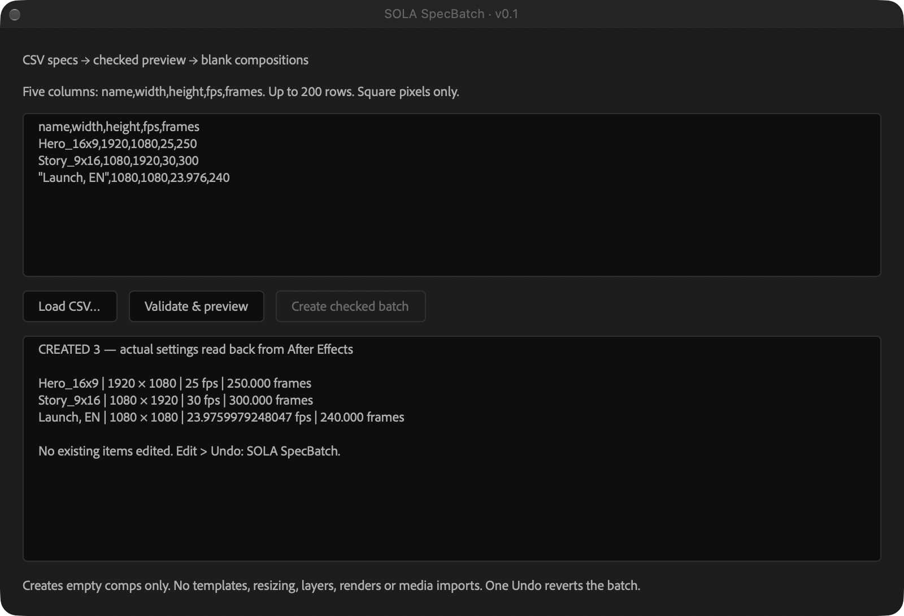

# SpecBatch Free for After Effects


Create blank compositions from CSV specifications, with a checked preview before creation.


For motion designers setting up a delivery list with different sizes, frame rates and durations. **Creates empty comps only:** it does not resize existing designs, replace text, import footage or render.





## Try the browser checker


[Check a CSV before opening After Effects](https://sola-chrome-orbit.kaoru-coccyx.chatgpt.site/after-effects-csv-compositions/). It uses this utility’s validation core, runs locally in your browser, and offers the same free v0.1 ZIP without an account. It checks your list only; it cannot see composition names already in an AE project. The browser does not create or render AE compositions.


## Download and run


1. Download the [v0.1 package](https://github.com/kaorukaore-x/specbatch-after-effects/releases/latest), or choose **Code → Download ZIP**.
2. Keep `SpecBatch.jsx` and `SpecBatchCore.js` in the same folder.
3. Save your work and open a separate test project in After Effects.
4. Choose **File → Scripts → Run Script File** and open `SpecBatch.jsx`.
5. Paste your CSV or choose **Load CSV…** and select a UTF-8 `.csv` file. Choose **Validate & preview**, inspect the settings, then **Create checked batch**.


No installer, account or network request is required by the script. After Effects itself is required and is not included.


```csv
name,width,height,fps,frames
Hero_16x9,1920,1080,25,250
Story_9x16,1080,1920,30,300
"Launch, EN",1080,1080,23.976,240
```


A new folder holds the new comps. Existing items are not edited. To undo, focus the main Project panel (use **Window → Project** if the floating palette has focus), then choose **Edit → Undo: SOLA SpecBatch** once per batch.


## Tested and untested


Tested in **After Effects 2026 on macOS**: five specs across two batches, including 3840×2160 at59.94fps, Japanese names, quoted commas and a one-frame comp. Actual comp settings were read back. Duplicate names and invalid width/fps were rejected; two batches were undone.


A separate 25 October 2026 test loaded `sample.csv` through the native macOS file picker and created three comps: 1920×1080 / 25 fps / 250 frames, 1080×1920 / 30 fps / 300 frames, and 1080×1080 / 23.976 fps / 240 frames. Actual settings were read back. That test batch was subsequently undone using **Window → Project**, then **Edit → Undo: SOLA SpecBatch** in the main application. The test folder disappeared and the Project panel was empty again. The floating palette did not need to be closed. Always use a separate test project first.

Windows, other AE versions, 200-row batches, and failure rollback are **unverified**. Limits in the code are not a claim that every boundary was tested. See [START_HERE.txt](START_HERE.txt).


## Optional motion background


Need an actual rendered background rather than blank comps? [Chrome Orbit — 4K and portrait MP4 pack ($5)](https://sola35.gumroad.com/l/chrome-orbit-4k-motion-loop?utm_source=github&utm_medium=opensource_readme&utm_campaign=ae_workflow_20261024&utm_content=optional_motion_pack) is a separate, optional paid asset. It is **not needed** to run this utility and its proprietary asset license is separate from this repository’s MIT code license.


## License and feedback


[MIT](LICENSE.txt). Original SOLA111 code with AI-assisted development. Not affiliated with Adobe. No bundled competitor code, stock imagery, fonts, templates or media.


Open an issue with your AE version, OS and a small non-confidential CSV example. Support and compatibility updates are not guaranteed. Do not include client files or personal information.

